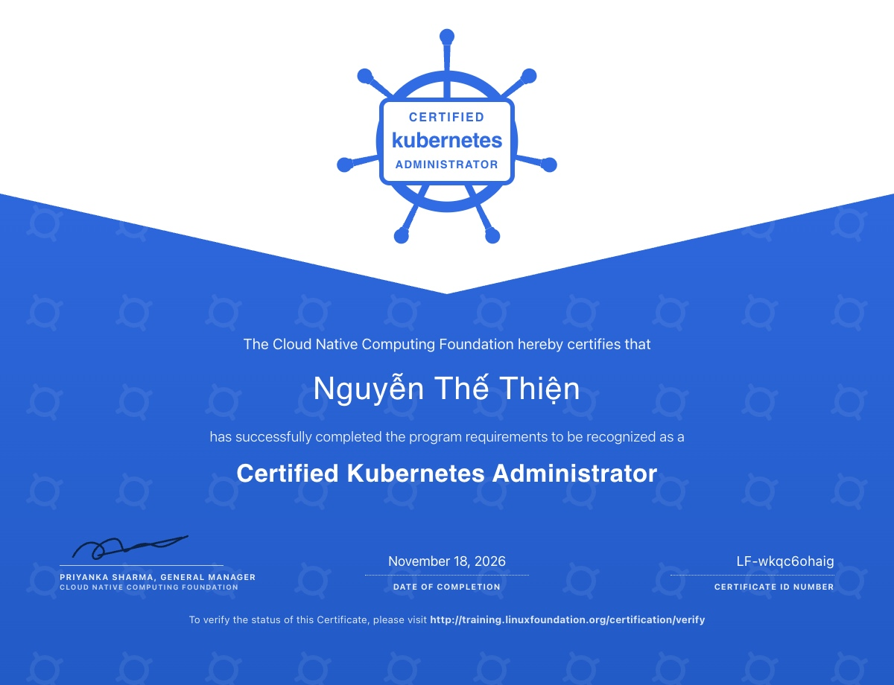

# Networking for Kubernetes — học từng bài nhỏ

Lộ trình dành cho Data Engineer muốn hiểu mạng từ nền tảng đến Kubernetes và Data Platform Engineering. Đây là bản chia nhỏ của [giáo trình 28 buổi](networking_for_kubernetes_28_buoi.md); file gốc được giữ nguyên để đối chiếu.

---

## 🎓 Chứng chỉ Tốt nghiệp (Certificate of Completion)

<p align="center">
  
</p>

> **Học viên:** Nguyễn Thế Thiện  
> **Trạng thái:** Đã hoàn thành xuất sắc **56/56 bài học** và đạt toàn bộ **7/7 Cổng đánh giá năng lực độc lập (CP1 đến Final)**.  
> **Credential ID:** `LF-wkqc6ohaig` (`NFK-2026-FINAL-7B4688B8`) · **Ngày cấp:** 18/11/2026.  
> **Chi tiết tiến độ & bằng chứng:** Xem tại [PROGRESS.md](PROGRESS.md), [notes/28a.md](notes/28a.md) và [notes/28b.md](notes/28b.md).

---

## Bắt đầu ở đâu?

1. Mở [bài 00 — Khởi động](lesson/00-khoi-dong.md) để xác nhận môi trường và cách lưu bằng chứng.
2. Xem [mục lục bài học](lesson/README.md), rồi học theo thứ tự `01a → 01b → 02a → … → 28b`.
3. Mỗi lần học, mở [PROGRESS.md](PROGRESS.md) để biết đang ở đâu và còn vướng gì.
4. Khi học với LLM, yêu cầu nó đọc [AGENTS.md](AGENTS.md) trước. File này quản lý cách dạy, không phải đáp án bài tập.

## Cách chia lộ trình

- **56 bài chính:** mỗi buổi gốc chia thành bài **a** và **b**, thường 30–60 phút/bài. Bài a xây mô hình và thực nghiệm nhỏ; bài b vận dụng, chẩn đoán hoặc hoàn thiện sản phẩm. Một số chủ đề như NAT, MTU có nội dung riêng ở bài b, không chỉ là bài ôn.
- **1 bài khởi động:** bài 00 không tính vào 56 bài chính.
- Có thể ghép hai bài thành một buổi 1–2 giờ, hoặc dừng giữa bài và ghi lại điểm nối tiếp. Không ép hoàn tất lab theo đồng hồ.
- Giữ **CP1–CP6 và Final** của giáo trình gốc. Chưa đạt checkpoint thì ôn hoặc làm lại trước khi chuyển giai đoạn.
- 3 buổi gốc/tuần tương đương khoảng 6 bài nhỏ/tuần: dự kiến 9–10 tuần, chưa tính ôn và chuẩn bị lab. Đây là nhịp tham khảo, không phải hạn chót.

| Giai đoạn | Bài nhỏ | Trọng tâm | Cổng đánh giá |
|---|---|---|---|
| 1 | 01a–04b | HTTP request, IP/CIDR, ARP, routing | CP1 |
| 2 | 05a–08b | TCP/UDP, lỗi kết nối, DNS, HTTP/TLS, NAT | CP2 |
| 3 | 09a–12b | Linux inventory, netns/veth/bridge, forwarding, firewall | CP3 |
| 4 | 13a–16b | Container/Pod, CNI, same-node và cross-node | CP4 |
| 5 | 17a–20b | Service, EndpointSlice, service proxy, CoreDNS | CP5 |
| 6 | 21a–24b | External access, Ingress, LoadBalancer, NetworkPolicy | CP6 |
| 7 | 25a–28b | Egress/MTU, incident response, Spark, thiết kế 4 VM | Final |

## Các file dùng hằng ngày

| File/thư mục | Vai trò |
|---|---|
| [lesson/](lesson/README.md) | Nội dung và tiêu chí của từng bài; không ghi tiến độ vào các file bài học |
| [PROGRESS.md](PROGRESS.md) | Trạng thái bài học, checkpoint, điểm đang dừng, lịch sử và hàng đợi ôn tập |
| [AGENTS.md](AGENTS.md) | Quy tắc cho LLM: challenge-first, gợi ý tăng dần, an toàn và cách cập nhật tiến độ |
| [STUDENT_PROFILE.md](STUDENT_PROFILE.md) | Mục tiêu, nền tảng và nhu cầu học; phân biệt thông tin từ đề cương với thông tin đã xác nhận |
| [LAB.md](LAB.md) | Môi trường thực tế, preflight, phạm vi thay đổi, rollback và giới hạn của lab |
| [CHECKPOINTS.md](CHECKPOINTS.md) | Đề đánh giá và tiêu chí đạt tại các cổng giai đoạn |
| [notes/](notes/README.md) | Ghi chú và bằng chứng của học viên, tạo khi thực sự học |
| [templates/LESSON_NOTE.md](templates/LESSON_NOTE.md) | Mẫu ghi chép mỗi bài |
| [templates/INCIDENT_REPORT.md](templates/INCIDENT_REPORT.md) | Mẫu điều tra sự cố, dùng lại ở Service/DNS, CNI, Spark |
| [templates/NETWORK_READINESS_REPORT.md](templates/NETWORK_READINESS_REPORT.md) | Mẫu sản phẩm cuối khóa cho 1 control-plane + 3 worker VM |

## Prompt cho phiên học mới

```text
Hãy làm gia sư Networking for Kubernetes của tôi trong repository này.
Đọc AGENTS.md, PROGRESS.md, STUDENT_PROFILE.md và LAB.md trước.
Chọn bài tiếp theo theo PROGRESS.md; nếu chưa bắt đầu, làm bài 00.
Chỉ dạy một bài nhỏ mỗi lần. Giải thích nền tảng ngắn, yêu cầu tôi dự đoán,
rồi giao challenge; đừng đưa toàn bộ lời giải ngay.
Chưa chạy hoặc yêu cầu thay đổi lab trước khi xác nhận đúng môi trường và quyền.
Cuối phiên, đánh giá bằng chứng và cập nhật tiến độ đúng với kết quả thực tế.
```

Nếu LLM không đọc được file trên máy, gửi nội dung các file trên và **chỉ bài đang học**. Yêu cầu nó trả về phần cập nhật tiến độ để bạn tự lưu; không coi lời nói “đã lưu” là bằng chứng file đã thay đổi.

## Nguyên tắc xuyên suốt

**Dự đoán → quan sát → giải thích → sửa có kiểm soát → kiểm tra lại.** Không đánh dấu đạt chỉ vì đã đọc bài hay lệnh cuối cùng chạy thành công. Không tạo sự cố trên VM công ty hoặc cluster dùng chung. Các cấu hình phụ thuộc phiên bản phải được kiểm tra theo môi trường thật trước khi áp dụng.
