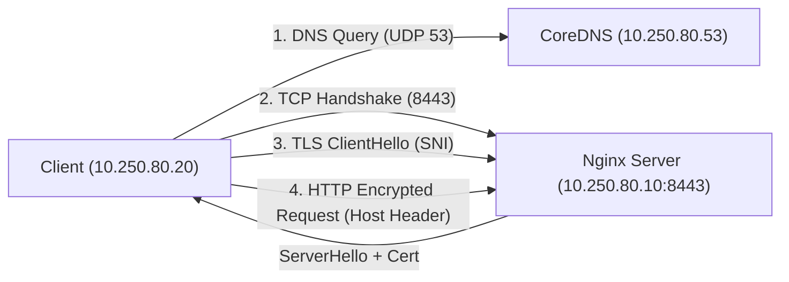

# 08a — URL, HTTP Host, TLS SNI và chứng chỉ

- Ngày/giờ (Asia/Ho_Chi_Minh): 2026-10-27 14:25
- Thời lượng: 40 phút
- Máy thực thi / OS / cluster context / namespace: macOS Darwin arm64 (OrbStack engine), Docker container client `nfk-08a-client`, server `nfk-08a-server` (Nginx), DNS `nfk-08a-dns` (CoreDNS)
- Phiên bản và tài liệu đã đối chiếu:
  - RFC 6066 (TLS Server Name Indication): https://datatracker.ietf.org/doc/html/rfc6066
  - curl Documentation (`--resolve`): https://curl.se/docs/manpage.html#--resolve
- Phạm vi được phép thay đổi: Subnet cô lập `nfk-08a` (`10.250.80.0/24`)

## Mục tiêu

- Phân biệt TCP destination, tên dùng cho DNS, HTTP Host và tên TLS cần xác thực.
- Phân loại HTTP error và TLS validation failure, không nhầm với lỗi kết nối TCP.
- Sử dụng `curl --resolve` để cô lập việc phân giải DNS khỏi quá trình kiểm tra TLS và định tuyến HTTP Host.
- Phân biệt rõ lỗi CA Trust failure vs Hostname Mismatch.

## Dự đoán trước lab

| Phép thử | Kết quả dự đoán | Vì sao / giả định |
|---|---|---|
| `curl -H "Host: secure.lab.internal" https://10.250.80.10:8443/` | Thất bại ở tầng TLS | URL mang IP `10.250.80.10`, client không gửi SNI `secure.lab.internal` và kiểm tra IP so với SAN của cert, gói HTTP request (Host header) chưa được gửi |
| Lỗi mạng phổ biến: Refused vs SSL vs 404/421 | Thuộc các tầng khác nhau | Refused (TCP L4), SSL problem (TLS Handshake), 404/421 (HTTP L7 Application) |

## Topology và địa chỉ IP

- Mạng Docker: `nfk-08a` (`10.250.80.0/24`)
- DNS Server: `10.250.80.53` (`nfk-08a-dns` - CoreDNS)
  - `secure.lab.internal` -> `10.250.80.10`
  - `other.lab.internal` -> `10.250.80.10`
- Web Server: `10.250.80.10` (`nfk-08a-server` - Nginx TLS trên port 8443)
  - Vhost `secure.lab.internal`: Cert SAN `DNS:secure.lab.internal`
  - Vhost `other.lab.internal`: Cert SAN `DNS:other.lab.internal`
- Client: `10.250.80.20` (`nfk-08a-client`)
- CA nội bộ: `CN=Lab-Internal-Root-CA`



## Các bước thực hành / câu lệnh

1. Gọi IP trực tiếp kèm `-H "Host: secure.lab.internal"`:
   ```bash
   docker exec nfk-08a-client curl -v -H "Host: secure.lab.internal" https://10.250.80.10:8443/
   ```
2. Gọi tên miền chuẩn bằng `curl --resolve` kèm `--cacert /tmp/ca.crt`:
   ```bash
   docker exec nfk-08a-client curl -v --cacert /tmp/ca.crt --resolve secure.lab.internal:8443:10.250.80.10 https://secure.lab.internal:8443/
   ```
3. Kiểm tra gọi tên miền khi chưa import CA (Trust failure):
   ```bash
   docker exec nfk-08a-client curl -v https://secure.lab.internal:8443/
   ```
4. Cài đặt CA vào OS trust store của client:
   ```bash
   docker exec nfk-08a-client cp /tmp/ca.crt /usr/local/share/ca-certificates/lab-ca.crt
   docker exec nfk-08a-client update-ca-certificates
   ```
5. Kiểm tra kết nối an toàn chuẩn (không cần cờ bypass):
   ```bash
   docker exec nfk-08a-client curl -s https://secure.lab.internal:8443/
   ```
6. Kiểm chứng lỗi Hostname Mismatch khi CA đã tin cậy:
   ```bash
   docker exec nfk-08a-client curl --resolve wrong.lab.internal:8443:10.250.80.10 https://wrong.lab.internal:8443/
   ```

## Bằng chứng

- **Bằng chứng 1 (Gọi IP thất bại ở TLS, HTTP chưa gửi):**
  ```text
  * Server certificate:
  *   subject: CN=other.lab.internal; O=NFK-Lab
  *   issuer: CN=Lab-Internal-Root-CA; O=NFK-Lab
  *  subjectAltName does not match IPv4 address 10.250.80.10
  * SSL: no alternative certificate subject name matches target IPv4 address '10.250.80.10'
  * closing connection #0
  curl: (60) SSL: no alternative certificate subject name matches target IPv4 address '10.250.80.10'
  ```
- **Bằng chứng 2 (`curl --resolve` gửi cả SNI và HTTP Host):**
  ```text
  > GET / HTTP/1.1
  > Host: secure.lab.internal:8443
  < HTTP/1.1 200 OK
  HTTP 200 OK: Welcome to SECURE API! (TLS SNI & Host: secure.lab.internal)
  ```
- **Bằng chứng 3 (Phân biệt Trust Failure vs Hostname Mismatch):**
  - Khi thiếu CA:
    `subjectAltName: "secure.lab.internal" matches cert's "secure.lab.internal"`
    `curl: (60) SSL certificate OpenSSL verify result: unable to get local issuer certificate (20)`
  - Khi có CA nhưng sai Hostname (`wrong.lab.internal`):
    `curl: (60) SSL: no alternative certificate subject name matches target hostname 'wrong.lab.internal'`
- **Bằng chứng 4 (Fix chuẩn bằng OS Trust store):**
  `HTTP 200 OK: Welcome to SECURE API! (TLS SNI & Host: secure.lab.internal)`

## Lỗi gặp phải và phân tích root cause

| Triệu chứng | Giả thuyết | Phép kiểm tra phân biệt | Bằng chứng / kết luận |
|---|---|---|---|
| `curl -H "Host: ..."` tới IP bị lỗi `curl: (60)` | TLS bắt buộc xác thực URL host trước khi gửi HTTP header | Soi log TLS handshake xem HTTP request đã gửi chưa | Log dừng tại TLS verify, không có dòng `> GET /` nào được phát |
| `unable to get local issuer certificate` | Client thiếu chứng chỉ CA gốc | Kiểm tra dòng `subjectAltName matches` | SAN đã khớp, lỗi do Trust Store chưa có Root CA |
| `no alternative certificate subject name matches` | Hostname URL không khớp SAN của cert | Kiểm tra trường `subjectAltName` trên cert | Cert chỉ có SAN cho `other.lab.internal`, không có `wrong.lab.internal` |

## Cách sửa và bằng chứng xác minh

- Thay vì tắt bảo mật bằng `-k`, ta đưa `ca.crt` vào `/usr/local/share/ca-certificates/` và chạy `update-ca-certificates`.
- Kết quả: `curl -s https://secure.lab.internal:8443/` trả về `HTTP 200 OK` trơn tru, bảo mật end-to-end.

## Rollback / dọn dẹp / tài nguyên còn giữ

- Lệnh thực thi:
  ```bash
  docker rm -f nfk-08a-client nfk-08a-server nfk-08a-dns
  docker network rm nfk-08a
  rm -rf scratch/08a
  ```
- Trạng thái kiểm tra: Đã dọn sạch 100% container, network và scratch directory. Không có nợ rollback.

## Review và tự giải thích

- 3 điều hiểu được:
  1. Header `-H "Host: ..."` nằm ở L7 HTTP bên trong đường hầm mã hóa, không thể thay thế TLS SNI và TLS hostname verification ở L6/L5.
  2. `--resolve <host>:<port>:<ip>` là công cụ chuẩn để kiểm thử HTTPS trực tiếp tới IP mà không can thiệp DNS hoặc `/etc/hosts`.
  3. Lỗi TLS `curl: (60)` có 2 nhánh độc lập: CA Trust failure (`unable to get local issuer certificate`) và Hostname mismatch (`subjectAltName does not match target hostname`).
- 2 điều còn thắc mắc:
  1. Kubernetes Ingress Controller (như Ingress-Nginx, Traefik) làm thế nào chọn đúng SSL Certificate khi có hàng chục domain khác nhau trỏ về cùng Ingress IP? (Nhờ TLS SNI trong Client Hello).
  2. Tại sao `-k` / `--insecure` bị cấm tuyệt đối trên production pipeline của Data Engineering? (Bỏ qua hoàn toàn bước xác thực danh tính server, dễ bị Man-in-the-Middle đọc trộm credentials/dữ liệu).
- 1 thử nghiệm tiếp theo: Áp dụng vào Ingress và Service mesh mTLS trong Kubernetes.
- Câu áp dụng sang tình huống khác và câu trả lời:
  - Khi Spark driver gọi S3 / MinIO qua HTTPS bị lỗi `unable to get local issuer certificate`, nguyên nhân là gì?
  - Trả lời: Do Java Virtual Machine (JVM) của Spark chưa trust CA nội bộ ký chứng chỉ của MinIO (cần import CA vào Java `cacerts` keystore).
- Mức gợi ý cao nhất / có xem lời giải không: Hint 1 (Định hướng quan sát log). Tự giải thích chính xác 100%.

## Bàn giao phiên sau

- Checkbox tiêu chí còn thiếu: Không có (Đạt toàn bộ tiêu chí bài 08a).
- Bước đang dừng / phép thử tiếp theo: Chuyển sang bài [08b — NAT, Port Mapping và Checkpoint 2](file:///Users/ssc1_4/Downloads/Networking-DE/lesson/08b-nat-port-mapping-va-cp2.md).
- Blocker và điều kiện gỡ chặn: Không có.
- Nợ rollback hoặc tài nguyên còn tồn tại: Không có.
