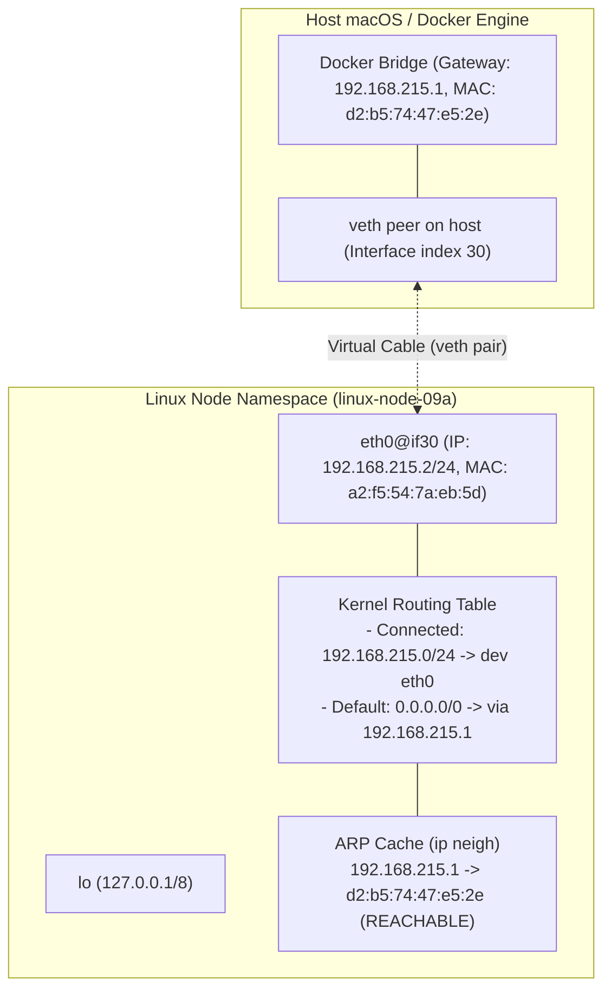

# 09a — Đọc trạng thái mạng một Linux host

- Ngày/giờ (Asia/Ho_Chi_Minh): 2026-11-02 14:30
- Thời lượng: 45 phút
- Máy thực thi / OS / cluster context / namespace: macOS Darwin arm64 (OrbStack engine), Docker container `nfk-09a-node` (image `nfk-07b-tools:local`, Ubuntu 24.04 LTS).
- Phiên bản và tài liệu đã đối chiếu:
  - iproute2 man pages: https://man7.org/linux/man-pages/man8/ip.8.html
  - ip-link(8): https://man7.org/linux/man-pages/man8/ip-link.8.html
  - ip-route(8): https://man7.org/linux/man-pages/man8/ip-route.8.html
  - ip-neighbour(8): https://man7.org/linux/man-pages/man8/ip-neighbour.8.html
  - Linux Virtual Networking - veth pair: https://developers.redhat.com/blog/2018/10/22/introduction-to-linux-interfaces-for-virtual-networking
- Phạm vi được phép thay đổi: Container lab cô lập `nfk-09a-node`, chỉ quan sát không thay đổi cấu hình mạng.

## Mục tiêu

- Lập inventory interface, addresses, routes và neighbors mà không làm thay đổi cấu hình mạng.
- Nhận diện và vẽ đúng ranh giới host/VM/container (veth pair peer) thay vì coi virtual NIC là card mạng vật lý.
- Kiểm chứng quyết định định tuyến của kernel cho 2 loại đích (cùng subnet on-link vs ngoài subnet via default gateway) qua `ip route get`.
- Đối chứng nguyên lý: Cấu hình L3 (IP) tồn tại không đồng nghĩa với L2 link UP (Reachability).

## Dự đoán trước lab

| Phép thử | Kết quả dự đoán | Vì sao / giả định | Khớp thực tế |
|---|---|---|---|
| Kiểm tra danh sách interface mặc định | Có `lo` (127.0.0.1) và `eth0` | Node/container tối thiểu luôn cần loopback nội bộ và 1 NIC ra ngoài | Đúng 100% |
| Kiểm tra bảng `ip neigh` ban đầu | Hoàn toàn rỗng (empty) | Node chưa phát sinh gói tin nào ra mạng nên kernel chưa gửi ARP request | Đúng 100% |
| `ip route get 192.168.215.5` (cùng subnet) | Gửi trực tiếp on-link qua `dev eth0` | Đích nằm trong connected prefix `192.168.215.0/24 scope link` | Đúng 100% |
| `ip route get 8.8.8.8` (ngoài subnet) | Đi qua gateway `192.168.215.1 dev eth0` | Khớp default route `default via 192.168.215.1 dev eth0` | Đúng 100% |

## Topology và địa chỉ IP



## Các bước thực hành / câu lệnh

Học viên trực tiếp thực thi các lệnh sau từ terminal:

1. Thu thập inventory toàn diện:
   ```bash
   docker exec nfk-09a-node bash -c '
   echo "=== 1. HOSTNAME ===" && hostname
   echo "=== 2. IP LINK (L2 Interfaces) ===" && ip -br link
   echo "=== 3. IP ADDR (L3 Addresses) ===" && ip -br addr
   echo "=== 4. IP ROUTE (L3 Routing Table) ===" && ip route
   echo "=== 5. IP NEIGH (L2/L3 Neighbors) ===" && ip neigh
   '
   ```
2. Kích hoạt ARP probe và kiểm tra neighbor cache:
   ```bash
   docker exec nfk-09a-node ping -c 1 192.168.215.1
   docker exec nfk-09a-node ip neigh
   ```
3. Kiểm chứng Next-hop route lookup:
   ```bash
   docker exec nfk-09a-node ip route get 192.168.215.5
   docker exec nfk-09a-node ip route get 8.8.8.8
   ```

## Bằng chứng

- **Bằng chứng 1: Inventory thô ban đầu:**
  ```text
  === 1. HOSTNAME ===
  linux-node-09a
  === 2. IP LINK (L2 Interfaces) ===
  lo               UNKNOWN        00:00:00:00:00:00 <LOOPBACK,UP,LOWER_UP>
  eth0@if30        UP             a2:f5:54:7a:eb:5d <BROADCAST,MULTICAST,UP,LOWER_UP>
  === 3. IP ADDR (L3 Addresses) ===
  lo               UNKNOWN        127.0.0.1/8 ::1/128
  eth0@if30        UP             192.168.215.2/24
  === 4. IP ROUTE (L3 Routing Table) ===
  default via 192.168.215.1 dev eth0
  192.168.215.0/24 dev eth0 proto kernel scope link src 192.168.215.2
  === 5. IP NEIGH (L2/L3 Neighbors) ===
  (rỗng)
  ```
- **Bằng chứng 2: Neighbor cache sau ARP resolution:**
  ```text
  192.168.215.1 dev eth0 lladdr d2:b5:74:47:e5:2e REACHABLE
  ```
- **Bằng chứng 3: Quyết định route lookup của Kernel cho 2 loại đích:**
  ```text
  192.168.215.5 dev eth0 src 192.168.215.2 uid 0 
      cache 
  8.8.8.8 via 192.168.215.1 dev eth0 src 192.168.215.2 uid 0 
      cache
  ```

## Bảng Network Inventory hoàn chỉnh

| Interface | Loại / Ranh giới | Trạng thái L2 | Địa chỉ IP (L3) / Prefix | Route liên quan | Ghi chú vai trò |
|---|---|---|---|---|---|
| `lo` | Virtual Loopback | `UNKNOWN` (UP) | `127.0.0.1/8`, `::1/128` | Local host table | IPC nội bộ bên trong node |
| `eth0` (`@if30`) | Virtual NIC (veth pair) | `UP` | `192.168.215.2/24` | `192.168.215.0/24 dev eth0`<br>`default via 192.168.215.1` | Cáp mạng ảo nối ra Docker bridge / host |

## Phân tích đối chứng / Break & Fix Case

- **Triệu chứng:** Worker node có IP `10.200.1.50/24` hiển thị trong `ip addr`, nhưng ping từ driver bị mất kết nối (Network unreachable / timeout).
- **Phép kiểm tra phân biệt:** Dùng `ip link show <dev>` hoặc `ip -br link` để kiểm tra cờ tầng L2/L1 (`UP`, `NO-CARRIER`, `DOWN`).
- **Kết luận bản chất:** IP chỉ là nhãn cấu hình logic tầng 3 (L3). Nếu tầng 1/2 không ở trạng thái `UP`/`LOWER_UP` thì kernel không thể đóng khung và phát tín hiệu qua môi trường truyền dẫn. Inventory cấu hình không đồng nghĩa với Connectivity.

## Rollback / dọn dẹp / tài nguyên còn giữ

- LLM tự động thực thi xóa container lab:
  ```bash
  docker rm -f nfk-09a-node
  ```
- Kiểm tra sau dọn dẹp: `docker ps -a --filter "name=nfk-"` trả về rỗng. Không còn tài nguyên tạm nào tồn tại.

## Review và tự giải thích

- 3 điều hiểu được:
  1. Bộ tứ công cụ `iproute2`: `ip link` (L2/MAC/State), `ip addr` (L3/IP/Mask), `ip route` (L3/Routing), `ip neigh` (L2-L3 ARP/Neighbor).
  2. Ký hiệu `@ifXX` (ví dụ `eth0@if30`) là bằng chứng của cặp cáp ảo `veth pair`, xác định ranh giới giữa container namespace và host/bridge.
  3. `ip route get` phân biệt rõ gửi trực tiếp on-link (cùng subnet) vs gửi qua next-hop gateway `via` (khác subnet); bảng `ip neigh` chỉ ghi nhận MAC sau khi có lưu lượng ARP thực tế.
- 2 điều còn thắc mắc: Sẽ tiếp tục làm rõ cách các socket lắng nghe (TCP/UDP listeners) ánh xạ với IP/Port của inventory ở bài 09b.
- 1 thử nghiệm tiếp theo: Khảo sát ma trận kết nối và bảng sockets trong bài [09b](lesson/09b-sockets-va-connectivity-matrix.md).
- Mức gợi ý cao nhất: Hint 1 (Định hướng câu hỏi phân tích veth pair và neighbor cache). Học viên tự dự đoán và thao tác chính xác toàn bộ.

## Bàn giao phiên sau

- Checkbox tiêu chí còn thiếu: Không còn, đạt 3/3 tiêu chí bài 09a.
- Bước đang dừng: Hoàn thành bài 09a (`dat`).
- Bước tiếp theo: Bắt đầu bài [09b — Sockets và connectivity matrix](lesson/09b-sockets-va-connectivity-matrix.md).
- Blocker: Không có.
- Nợ rollback: Không có (đã dọn sạch container `nfk-09a-node`).
- Kết quả cần phản ánh vào PROGRESS.md: Chuyển 09a sang `dat`.
