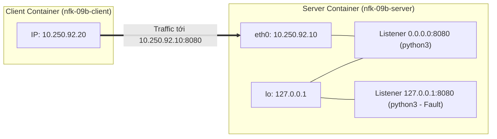

# 09b — Sockets, listener và connectivity matrix

- Ngày/giờ (Asia/Ho_Chi_Minh): 2026-11-02 16:10
- Thời lượng: 40 phút
- Máy thực thi / OS / cluster context / namespace: macOS Darwin arm64 (OrbStack engine), Docker network `nfk-09b` (`10.250.92.0/24`), Docker containers `nfk-09b-server` (`10.250.92.10`) và `nfk-09b-client` (`10.250.92.20`) từ image `nfk-07b-tools:local` (Alpine Linux).
- Phiên bản và tài liệu đã đối chiếu:
  - ss(8) man page: https://man7.org/linux/man-pages/man8/ss.8.html
  - Linux socket API bind(2): https://man7.org/linux/man-pages/man2/bind.2.html
  - RFC 793 (Transmission Control Protocol - TCP Sockets & Listen States): https://datatracker.ietf.org/doc/html/rfc793
- Phạm vi được phép thay đổi: Network `nfk-09b`, service listener bên trong `nfk-09b-server`.

## Mục tiêu

- Bổ sung sockets/listeners vào inventory mạng bằng công cụ chuẩn `ss -lntup`.
- Thiết lập và đo kiểm Ma trận kết nối (**Connectivity Matrix**) gồm đủ 5 trường (Source, Destination IP:Port, Protocol, Expected, Actual).
- Chứng minh thực tế: *Ping L3 thành công không đồng nghĩa với dịch vụ L4 khả dụng*.
- Khoanh vùng và khắc phục lỗi service bind nhầm loopback `127.0.0.1` thay vì wildcard `0.0.0.0` mà không làm thay đổi firewall hay routing của host.

## Dự đoán trước lab

| Phép thử | Kết quả dự đoán | Vì sao / giả định | Khớp thực tế |
|---|---|---|---|
| Lệnh `ss -lntup` chạy bởi user thường | Không thấy tên process / PID của user khác | Linux kernel ẩn thông tin process của user khác nếu thiếu quyền | Đúng 100% |
| `curl` nội bộ server thành công thì client ngoài có chắc chắn thành công không? | Không chắc chắn | Có thể bị chặn firewall hoặc server chỉ bind `127.0.0.1` | Đúng 100% |

## Topology và địa chỉ IP



## Các bước thực hành / câu lệnh

Học viên trực tiếp thực thi trên terminal máy Mac:

1. Kiểm tra inventory IP và Sockets trên server:
   ```bash
   docker exec nfk-09b-server ip -br addr
   docker exec nfk-09b-server ss -lntup
   ```
2. Thực thi Baseline Connectivity Matrix (4 phép thử):
   ```bash
   echo "=== T1: Client -> Server:8080 ===" && docker exec nfk-09b-client curl -s -I http://10.250.92.10:8080/ | head -n 1
   echo "=== T2: Server -> Local:8080 ===" && docker exec nfk-09b-server curl -s -I http://127.0.0.1:8080/ | head -n 1
   echo "=== T3: Client -> Server:8888 (Control fail) ===" && docker exec nfk-09b-client curl -v --connect-timeout 2 http://10.250.92.10:8888/ 2>&1 | grep -E "Trying|refused|Connected"
   echo "=== T4: Client ping Server (L3 check) ===" && docker exec nfk-09b-client ping -c 1 10.250.92.10 | grep -E "packets transmitted|rtt"
   ```
3. Điều tra sự cố listener ẩn nguyên nhân:
   ```bash
   docker exec nfk-09b-client curl -v --connect-timeout 2 http://10.250.92.10:8080/ 2>&1 | grep -E "Trying|refused|Connected"
   docker exec nfk-09b-server ss -lntup
   ```
4. Sửa cấu hình và đối chứng phục hồi:
   ```bash
   docker exec nfk-09b-server pkill -f python3
   docker exec -d nfk-09b-server python3 -m http.server 8080 --bind 0.0.0.0
   docker exec nfk-09b-server ss -lntup | grep 8080
   docker exec nfk-09b-client curl -s -I http://10.250.92.10:8080/ | head -n 1
   ```

## Bằng chứng

- **Bằng chứng 1: Baseline Connectivity Matrix:**
  ```text
  === T1: Client -> Server:8080 ===
  HTTP/1.0 200 OK
  === T2: Server -> Local:8080 ===
  HTTP/1.0 200 OK
  === T3: Client -> Server:8888 (Control fail) ===
  *   Trying 10.250.92.10:8888...
  * connect to 10.250.92.10 port 8888 from 10.250.92.20 port 47930 failed: Connection refused
  === T4: Client ping Server (L3 check) ===
  1 packets transmitted, 1 packets received, 0% packet loss
  ```
- **Bằng chứng 2: Điều tra bắt lỗi listener bind sai:**
  ```text
  * connect to 10.250.92.10 port 8080 from 10.250.92.20 port 58380 failed: Connection refused
  Output ss trên server:
  tcp LISTEN 0 5 127.0.0.1:8080 0.0.0.0:* users:(("python3",pid=6,fd=3))
  ```
- **Bằng chứng 3: Đối chứng sau khi sửa về `0.0.0.0`:**
  ```text
  === 1. KIỂM TRA SOCKET INVENTORY TRÊN SERVER ===
  tcp LISTEN 0 5 0.0.0.0:8080 0.0.0.0:* users:(("python3",pid=58,fd=3))
  === 2. KIỂM TRA KẾT NỐI TỪ CLIENT SANG SERVER ===
  HTTP/1.0 200 OK
  ```

## Ma trận kết nối hoàn chỉnh (Connectivity Matrix)

| Test ID | Vị trí nguồn | Đích (IP:Port) | Protocol / Layer | Kết quả trước sửa | Kết quả sau sửa | Bản chất chẩn đoán |
|---|---|---|---|---|---|---|
| **T1** | Client (`10.250.92.20`) | `10.250.92.10:8080` | TCP / HTTP | **Connection refused** | **HTTP 200 OK** | Trước sửa: bind loopback nên từ chối. Sau sửa: bind wildcard `0.0.0.0` nên chấp nhận kết nối. |
| **T2** | Server (`10.250.92.10`) | `127.0.0.1:8080` | TCP / HTTP | **HTTP 200 OK** | **HTTP 200 OK** | Luôn thành công vì loopback socket luôn sẵn sàng cho nội bộ. |
| **T3** | Client (`10.250.92.20`) | `10.250.92.10:8888` | TCP / HTTP | **Connection refused** | **Connection refused** | Control test: Port chưa mở luôn bị kernel phản hồi TCP RST. |
| **T4** | Client (`10.250.92.20`) | `10.250.92.10` | ICMP (L3) | **0% packet loss** | **0% packet loss** | Tầng 3 luôn thông suốt trong suốt quá trình thử nghiệm. |

## Lỗi gặp phải và phân tích root cause

| Triệu chứng | Giả thuyết | Phép kiểm tra phân biệt | Bằng chứng / kết luận |
|---|---|---|---|
| Client gọi `10.250.92.10:8080` bị `Connection refused`, dù server nội bộ gọi `127.0.0.1:8080` được và ping thông | 1. Bị firewall DROP<br>2. Sai routing<br>3. Service bind loopback | Chạy `ss -lntup` trên server | Thấy `127.0.0.1:8080`. Loại trừ hoàn toàn giả thuyết firewall và routing. Root cause: bind loopback only. |

## Cách sửa và bằng chứng xác minh

- Khởi động lại service HTTP với cờ `--bind 0.0.0.0`.
- Socket hiển thị `0.0.0.0:8080`.
- Client gọi ngay lập tức nhận `HTTP/1.0 200 OK`. Không cần chạm vào interface, routing table hay firewall của host.

## Rollback / dọn dẹp / tài nguyên còn giữ

- LLM tự động thực thi xóa sạch tài nguyên lab:
  ```bash
  docker rm -f nfk-09b-server nfk-09b-client
  docker network rm nfk-09b
  ```
- Kiểm tra sau dọn dẹp: `docker ps -a --filter "name=nfk-"` và `docker network ls --filter "name=nfk-"` đều trả về rỗng.

## Review và tự giải thích

- 3 điều hiểu được:
  1. Ý nghĩa các cờ `ss -lntup`: `-l` (listening), `-n` (numeric), `-t` (TCP), `-u` (UDP), `-p` (process).
  2. Sự khác biệt chí mạng giữa `0.0.0.0:port` (lắng nghe mọi card mạng) và `127.0.0.1:port` (chỉ lắng nghe loopback).
  3. Lập Connectivity Matrix giúp tách bạch tầng L3 (ping thông) và tầng L4 (socket listen), không đổ lỗi oan cho firewall/network.
- 2 điều còn thắc mắc: Tiếp tục tìm hiểu cách Linux network namespace cô lập hoàn toàn bảng socket và interface ở bài 10a.
- 1 thử nghiệm tiếp theo: Tạo và nối 2 network namespace độc lập bằng veth pair trong bài [10a](lesson/10a-network-namespace-va-veth.md).
- Câu áp dụng sang tình huống khác: Trong Kubernetes, nếu một container trong Pod cấu hình bind vào `localhost:8080`, các container khác cùng Pod có thể gọi được qua `localhost:8080`, nhưng Service hoặc Ingress từ ngoài Pod gọi vào Pod IP `10.244.x.y:8080` sẽ bị `Connection refused` ngay lập tức!
- Mức gợi ý cao nhất: Tự làm / không cần gợi ý. Học viên tự phát hiện `127.0.0.1:8080` trong output `ss` và tự đề xuất đổi sang `0.0.0.0`.

## Bàn giao phiên sau

- Checkbox tiêu chí còn thiếu: Không còn, đạt 3/3 tiêu chí bài 09b.
- Bước đang dừng: Hoàn thành bài 09b (`dat`).
- Bước tiếp theo: Bắt đầu bài [10a — Namespace và veth](lesson/10a-network-namespace-va-veth.md).
- Blocker: Không có.
- Nợ rollback: Không có (toàn bộ container và network `nfk-09b` đã được LLM dọn sạch).
- Kết quả cần phản ánh vào PROGRESS.md: Chuyển 09b sang `dat`.
