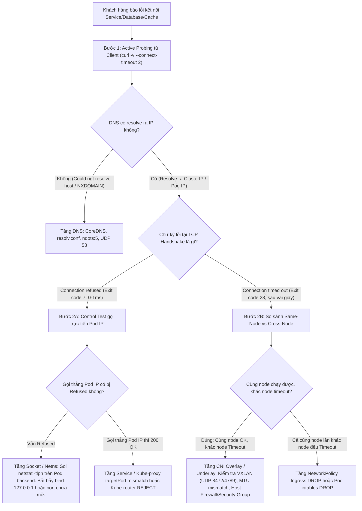

# 26b — Fix tối thiểu, rollback và regression checks

- Ngày/giờ (Asia/Ho_Chi_Minh): 2026-11-17 23:40
- Thời lượng: 60 phút
- Máy thực thi / OS / cluster context / namespace: Mac `SSC1s-Mac-mini-4.local` (Darwin arm64) | k3d v5.8.3 | context `k3d-de-k3d` | namespaces `nfk-26a-case1`, `nfk-26b-case2`, `nfk-26b-case3`
- Phiên bản và tài liệu đã đối chiếu: K3s `v1.33.6+k3s1`, Flannel VXLAN, Kube-router NetworkPolicy, curl 8.12.1, python 3.11-alpine, netstat, iptables v1.8.10
- Phạm vi được phép thay đổi: Namespaces `nfk-26a-case1`, `nfk-26b-case2`, `nfk-26b-case3`, iptables trên node `k3d-de-k3d-agent-1`

## Mục tiêu

- Hoàn tất 3 sự cố độc lập đại diện cho 3 tầng trọng yếu trong Kubernetes Networking:
  1. Case 1: Tầng ứng dụng / Socket binding (`metadata-store`).
  2. Case 2: Tầng Host Underlay / CNI Overlay Network (`feature-cache`).
  3. Case 3: Tầng Bảo mật / NetworkPolicy Ingress (`metrics-collector`).
- Thực hiện phương án fix tối thiểu cho từng case, có kế hoạch rollback và bộ kiểm tra hồi quy (regression checks: positive check, direct control check, negative control check).
- Đúc kết Playbook xử lý sự cố mạng cho Data Platform Engineer.

## Dự đoán trước lab

| Phép thử | Kết quả dự đoán | Vì sao / giả định |
|---|---|---|
| Fix tối thiểu Case 1 | Sửa bind socket từ `127.0.0.1` sang `0.0.0.0` | Để socket lắng nghe trên mọi card mạng của Pod (cả `lo` và `eth0`), xóa bỏ TCP RST |
| Bản chất khác biệt Case 1 vs Case 2 | Case 1 bị `Connection refused` (1ms), Case 2 bị `Connection timed out` (2s) | Case 1 đích nhận được và chủ động RST; Case 2 gói tin bị âm thầm DROP (silent drop) trên đường truyền overlay |
| Kiểm tra an toàn Case 3 (Negative control) | Client không phận sự (`analytics-client`) vẫn bị từ chối kết nối | Chứng minh bản fix chỉ mở đúng luồng cho `prometheus-scraper`, không mở toang ranh giới bảo mật |

## Báo cáo sự cố chi tiết và Playbook

### 1. Báo cáo 3 sự cố độc lập
- **Case 1 (Tầng Socket/App):** [notes/incident-26a-case1.md](incident-26a-case1.md) — Sửa `metadata-store` bind sang `0.0.0.0:8080`, giải mã bẫy Kubelet loopback exec probe.
- **Case 2 (Tầng CNI Overlay/Host Underlay):** [notes/incident-26b-case2.md](incident-26b-case2.md) — Bắt quả tang và xóa rule iptables DROP gói tin Flannel VXLAN UDP 8472 trên Node đích.
- **Case 3 (Tầng NetworkPolicy/Security):** [notes/incident-26b-case3.md](incident-26b-case3.md) — Sửa label mismatch trong Ingress rule và kiểm chứng negative control.

---

### 2. Playbook xử lý sự cố mạng Kubernetes (Mental Model cho Data Platform)

---

## Các bước thực hành / câu lệnh đã thực hiện

### Case 1 (`nfk-26a-case1`):
1. Fix tối thiểu: Thay `('127.0.0.1', 8080)` bằng `('0.0.0.0', 8080)` trong mã server của Pod `metadata-store`.
2. Regression checks:
   - `kubectl -n nfk-26a-case1 exec metadata-store -- netstat -tlpn` -> `0.0.0.0:8080 LISTEN`.
   - `kubectl -n nfk-26a-case1 exec data-ingest -- curl -v http://metadata-store` -> `HTTP 200 OK`.
   - `kubectl -n nfk-26a-case1 exec data-ingest -- curl -v http://10.42.1.68:8080` -> `HTTP 200 OK`.
3. Dọn dẹp: Đã xóa namespace `nfk-26a-case1`.

### Case 2 (`nfk-26b-case2`):
1. Triệu chứng: `client-local` (cùng node) gọi `http://feature-cache` -> 200 OK; `client-cross` (khác node) -> `Connection timed out` (exit code 28). Gọi trực tiếp Pod IP cũng timeout.
2. Triage: Soi iptables trên node đích `k3d-de-k3d-agent-1` thấy rule DROP `udp dpt:8472` từ `192.168.155.3`.
3. Fix tối thiểu: `docker exec k3d-de-k3d-agent-1 iptables -D INPUT -s 192.168.155.3 -p udp --dport 8472 -j DROP`.
4. Regression checks:
   - `client-cross` gọi Service `http://feature-cache` -> `HTTP 200 OK`.
   - `client-cross` gọi direct Pod IP `http://10.42.1.69:8080` -> `HTTP 200 OK`.
   - `client-local` gọi `http://feature-cache` -> `HTTP 200 OK`.
5. Dọn dẹp: Đã xóa namespace `nfk-26b-case2`.

### Case 3 (`nfk-26b-case3`):
1. Triệu chứng: `prometheus-scraper` gọi `metrics-collector:9090` -> `Connection refused` sau 1ms. Backend `metrics-collector` nghe `0.0.0.0:9090`.
2. Triage: `kubectl get netpol -o yaml` phát hiện rule ingress yêu cầu nhãn `role: metric-scraper` trong khi Pod scraper mang nhãn `role: scraper`. Kube-router trong K3s dùng `REJECT icmp-port-unreachable`.
3. Fix tối thiểu: Patch NetworkPolicy sửa `role: scraper`.
4. Regression checks:
   - Positive check: `prometheus-scraper` gọi `metrics-collector:9090` -> `HTTP 200 OK`.
   - Negative control: `analytics-client` (`role=query`) gọi `metrics-collector:9090` -> `Connection refused` (vẫn bị chặn).
5. Dọn dẹp: Đã xóa namespace `nfk-26b-case3`.

---

## Review và tự giải thích

- **3 điều hiểu được:**
  1. Phân biệt rạch ròi TCP RST (`Connection refused`) vs Silent DROP (`Connection timed out`): một bên đích chủ động từ chối, một bên gói tin bị nuốt mất trên đường truyền.
  2. Sự khác biệt giữa lưu lượng nội node (đi qua local bridge) và liên node (bắt buộc đóng gói qua CNI overlay như Flannel VXLAN UDP 8472).
  3. Kỹ năng Negative Control khi fix NetworkPolicy: fix an toàn là fix đúng luồng bị lỗi mà vẫn giữ nguyên ranh giới chặn các luồng không phận sự.
- **2 điều còn thắc mắc / đào sâu:**
  1. Khi dùng CNI Cilium với eBPF, cơ chế REJECT/DROP có hiển thị trong iptables không hay phải dùng `cilium monitor`? (Cilium xử lý trực tiếp tại hook eBPF của kernel, bypass hoàn toàn iptables).
  2. Làm thế nào để tự động hóa negative control test trong CI/CD pipeline trước khi deploy NetworkPolicy?
- **1 thử nghiệm tiếp theo:**
  - Áp dụng toàn bộ kiến thức phân tích luồng liên node và Service để phân tích kiến trúc mạng của Apache Spark (Driver - Executor - BlockManager) trong bài [27a](file:///Users/ssc1_4/Downloads/Networking-DE/lesson/27a-spark-driver-executor-baseline.md).
- **Câu áp dụng sang tình huống khác:**
  - *Tình huống:* Spark Driver chạy trên Kubernetes submit job nhưng các Executor ở worker node khác không thể gửi heartbeat về Driver (bị timeout), trong khi Executor chạy cùng node với Driver vẫn hoạt động.
  - *Giải thích:* Bắt nguồn từ cấu hình `spark.driver.bindAddress` bind sai interface, hoặc Security Group giữa các worker nodes chặn dải cổng giao tiếp nội bộ của Spark (`spark.blockManager.port` / RPC port) hoặc CNI overlay port.
- **Mức gợi ý cao nhất:** Hint 2 (định hướng tầng mạng và cung cấp lệnh đo lường tối thiểu).

---

## Bàn giao phiên sau

- **Tiêu chí bài 26b:** Đạt toàn bộ 3/3 incidents, có bằng chứng post-fix, regression control, negative control, playbook và cleanup sạch.
- **Bài tiếp theo:** [27a — Spark networking baseline](file:///Users/ssc1_4/Downloads/Networking-DE/lesson/27a-spark-driver-executor-baseline.md).
- **Nợ rollback hoặc tài nguyên còn tồn tại:** Không có. Tất cả namespace tạm (`nfk-*`) và rule iptables đã được hoàn nguyên/xóa sạch.
